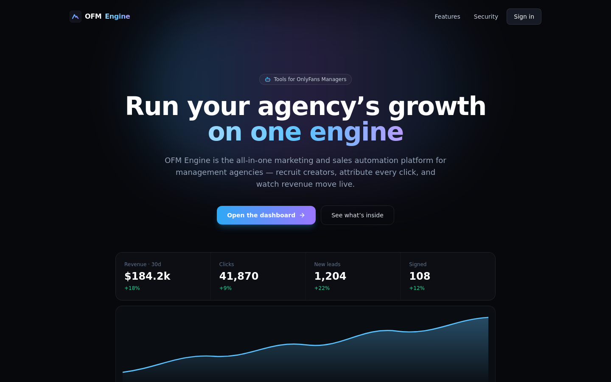
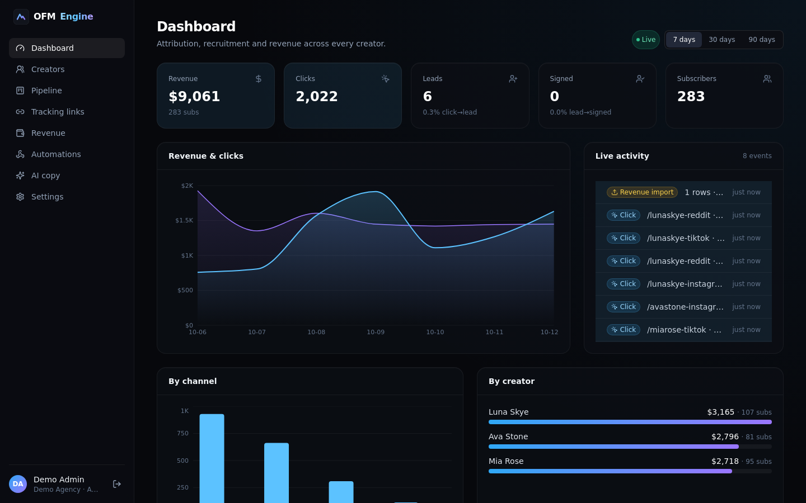
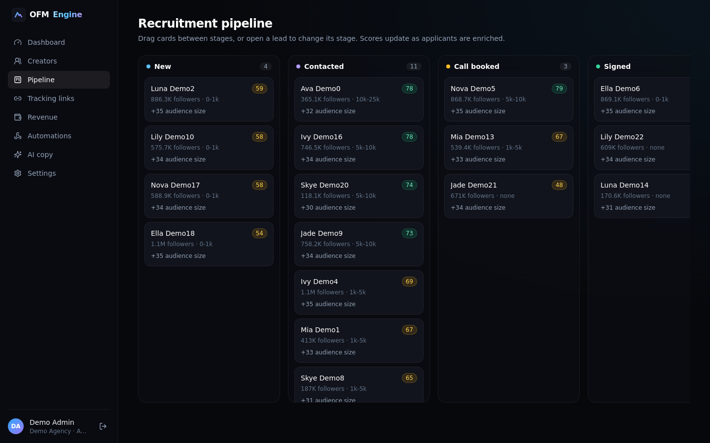
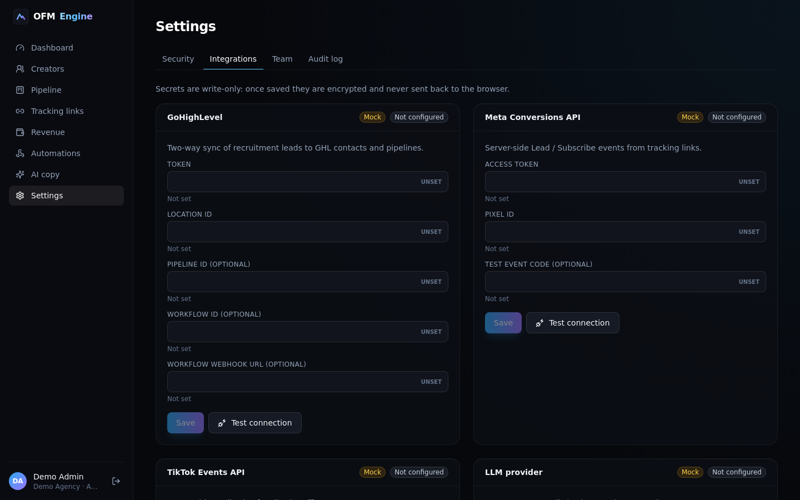
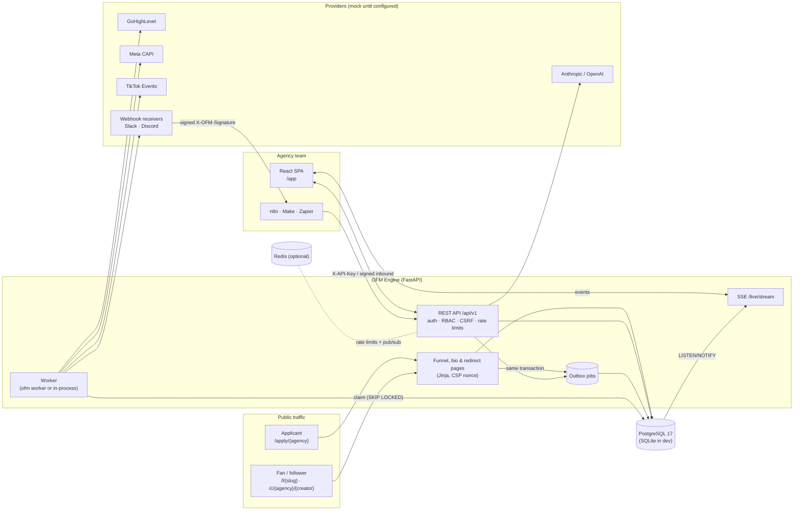

# OFM Engine

**Tools for OnlyFans Managers** — an all-in-one marketing, tracking and automation platform for
OnlyFans management agencies.

[](https://github.com/fernandogarzaaa/OMFE/actions/workflows/ci.yml)
[](https://github.com/fernandogarzaaa/OMFE/releases)
[](LICENSE)


OFM Engine runs the growth side of an agency in one place. A compliant creator-recruitment
funnel scores every applicant and syncs them into a **GoHighLevel** pipeline; tracking links and
link-in-bio pages attribute traffic per creator and channel, with **Meta Conversions API** and
**TikTok Events API** sent server-side; revenue exports are imported from CSV and rolled into a
**live dashboard** streamed over Server-Sent Events; and every event can fan out to **n8n, Make
or Zapier** through signed webhooks. An AI copy assistant with hard guardrails drafts recruitment
ads and follow-ups. It is multi-tenant with role-based access, encrypts every integration key at
rest, and **every integration runs in mock mode** until credentials are added — so the whole
system can be evaluated for $0 with nothing leaving the machine.

| Landing | Live dashboard |
|---|---|
|  |  |
| **Recruitment pipeline** | **Settings → Integrations** |
|  |  |

---

## Contents

[Features](#features) · [Architecture](#architecture) · [Quickstart](#quickstart) ·
[Demo logins](#demo-logins) · [Go-live checklist](#go-live-checklist) · [CLI](#cli-reference) ·
[Security](#security-highlights) · [Quality](#quality) · [Deploy](#deploy) · [Docs](#documentation) ·
[License](#license)

## Features

**Creator recruitment**
- Server-rendered application funnel at `/apply/{agency}` (works without JavaScript) with A/B
  headline variants (sticky per visitor, `?v=B` override), per-tenant branding, a honeypot bot trap
  and a 30/min/IP rate limit.
- Mandatory **18+ confirmation and contact consent**; the consent text version and timestamp are
  stored with every lead. Re-applying with the same email is idempotent.
- Transparent **lead scoring** (0–100 → hot / warm / cold) from audience size (log scale),
  multi-platform reach, stated earnings, phone/socials and target timezones; every point is
  explained in a breakdown, and weights/tier cut-offs are configurable per agency.
- Kanban **pipeline** (`new → contacted → call_booked → signed / lost`); stage changes sync to GHL
  and emit webhooks.

**GoHighLevel CRM sync** (LeadConnector API v2)
- Contact upsert with `tier-hot|warm|cold` + base tags, a score-breakdown note, optional custom
  fields (`lead_score`, `total_followers`, `earnings_range`) and optional workflow enrolment.
- Opportunity created in your recruitment pipeline and moved as the lead's stage changes
  (`won` on signed, `lost` on lost).
- Connection test from Settings; every call goes through a durable outbox with retries.

**Tracking & attribution**
- Short tracking links `/l/{slug}` per creator/channel/campaign: UTM pass-through, `fbclid` →
  `_fbc`, first-party `_fbp`, bot filtering, device detection and daily click rollups.
- Optional Pixel interstitial that shares one `event_id` between the browser Pixel and a
  server-side CAPI `ViewContent`, so Meta de-duplicates them.
- Link-in-bio pages at `/c/{agency}/{creator}`.
- **Meta CAPI** (`Lead` on application, `ViewContent` on opted-in clicks) and **TikTok Events API**
  (`SubmitForm`) with Meta's normalisation + SHA-256 hashing rules; `test_event_code` support.

**Revenue & live dashboard**
- CSV import with column mapping and date formats (samples for an OnlyFans statement and an
  Infloww-style export in [`samples/`](samples/)); rows de-duplicated by content hash.
- KPIs for 7/30/90 days: clicks, leads, signed, subs, revenue, conversion rates, by channel and
  by creator, plus a timeseries.
- Live activity feed and KPI counters over **SSE** (resumable with `Last-Event-ID`; fanned out
  across instances with Postgres `LISTEN/NOTIFY`, or Redis).

**Automations**
- Outbound webhooks for `lead.created`, `lead.stage_changed`, `link.clicked`, `revenue.imported`,
  `creator.updated` (or `*`), signed `X-OFM-Signature: t=…,v1=HMAC-SHA256`.
- Signed inbound endpoint so n8n/Make/Zapier can move leads back (`lead.stage`), with a 5-minute
  window and replay rejection.
- Ready-to-import [n8n workflows, a Make blueprint and Zapier recipes](integrations/README.md);
  SFW follow-up [sequences](sequences/README.md) for GHL workflows; Slack/Discord alerts for
  hot and warm leads.
- Scoped **API keys** (`X-API-Key`) for automation tools; job monitor with one-click retry of
  dead jobs.

**AI copy assistant**
- Recruitment ads, headlines, follow-up SMS/email and social captions via Anthropic or OpenAI
  (deterministic mock by default). Guardrails refuse sexually explicit content, anything
  referencing minors, and impersonating creators or fake personas — before and after generation.

**Platform**
- Multi-tenant (one database, many agencies), admin/member roles and service API keys, audit
  log, TOTP 2FA.
- Per-agency config in version-controlled YAML ([`clients/demo.yaml`](clients/demo.yaml)), with
  admin overrides from the UI and secrets only in the encrypted vault or environment.

## Architecture



A single Python package serves the API, the public pages and the built SPA. Side effects never
run inside the request: they are written to an outbox in the same transaction as the business
change and executed by the worker with retries and idempotency keys. Details in
[docs/architecture.md](docs/architecture.md).

**Stack:** Python 3.12 · FastAPI · SQLAlchemy 2 · Alembic · Pydantic v2 · Typer · httpx ·
argon2-cffi · cryptography · React 18 · Vite · TypeScript · Tailwind · TanStack Query · Recharts.

## Quickstart

### Docker Compose (mock mode, $0)

```bash
git clone https://github.com/fernandogarzaaa/OMFE.git && cd OMFE
docker compose up --build            # app + worker + Postgres 17, demo tenant seeded
open http://localhost:8000           # landing → Sign in
open http://localhost:8000/apply/demo   # the public creator funnel
```

Optional profiles: `docker compose --profile redis --profile n8n up` adds Redis (shared rate
limits + pub/sub) and n8n on <http://localhost:5678> with the bundled workflows mounted at
`/import`. The compose file uses throwaway dev secrets and `ENV=development`; never expose it to
the internet as-is.

### Local development

Requirements: Python 3.12, Node 22.

```bash
make install                         # .venv from hash-pinned locks + editable package; frontend npm ci
make seed                            # demo tenant with the known demo passwords
make dev                             # http://localhost:8000 — API + built SPA + in-process worker (SQLite)
.venv/bin/ofm seed-demo --stream     # optional: synthetic clicks/leads so the dashboard moves
```

No `make`? The equivalent is
`python -m venv .venv && .venv/bin/pip install --require-hashes -r requirements/build.lock -r requirements/dev.lock && .venv/bin/pip install --no-deps --no-build-isolation -e .`
then `ofm seed-demo --known-passwords` and `RUN_WORKER_IN_PROCESS=true ofm serve`.

Frontend only, no backend at all — an in-browser mock API with a live-moving dashboard:

```bash
cd frontend && npm ci && npm run dev:mock     # http://localhost:5173
```

For frontend work against the real backend, run `make dev` and `npm run dev` in `frontend/`
(Vite proxies `/api`, `/l` and `/apply` to `:8000`). Build the SPA into the Python package with
`make frontend`.

## Demo logins

| Email | Role | Password |
|---|---|---|
| `admin@demo.agency` | admin | `demo-pass-2026` |
| `member@demo.agency` | member | `demo-pass-2026` |
| `owner@demo.agency` | admin with 2FA (TOTP code `123456`) | `demo-pass-2026` — **in-browser mock only** |

The known password comes from `ofm seed-demo --known-passwords` (used by `make seed` and Docker
Compose). Without the flag, `seed-demo` generates random passwords and prints them once. The flag
is **refused when `ENV=production`**.

## Go-live checklist

Integrations switch from mock to live **per agency** as soon as their required fields are set.
Secrets pasted in **Settings → Integrations** (admin only) are envelope-encrypted and never
returned by the API; identifiers are stored as tenant overrides. Anything that is not on the
Settings page goes in the agency's YAML (`clients/<slug>.yaml`, no secrets) or in environment
variables. Tenant-scoped secrets can also come from the environment as `CLIENT_<SLUG>_<NAME>`
(slug upper-cased, dashes → underscores, e.g. `CLIENT_ACME_AGENCY_GHL_TOKEN`); the vault wins
when both are set.

### 1. Server secrets (environment)

| Variable | Value | How to generate |
|---|---|---|
| `ENV` | `production` — boot is refused while any dev secret remains | — |
| `DATABASE_URL` | `postgresql://…` (SQLite is refused in production) | your provider |
| `PUBLIC_BASE_URL` | `https://your-domain` — used in CAPI `event_source_url` and funnel links | — |
| `MASTER_KEYS` | Fernet key(s), comma-separated, newest first | `ofm gen-key` |
| `JWT_SECRET` | random, 32+ chars | `python -c "import secrets;print(secrets.token_urlsafe(48))"` |
| `PII_HASH_SALT` | random; **never change after go-live** (keys every stored PII hash) | same as above |
| `METRICS_TOKEN` | bearer token for `/metrics` (404 when unset) | same as above |
| `FORWARDED_ALLOW_IPS` | proxy IPs trusted for `X-Forwarded-For/Proto` (`*` behind a managed LB) | — |
| `CORS_ORIGINS` | only if the SPA is served from another origin | — |
| `REDIS_URL` | optional; shared rate limits across instances | — |
| `RUN_WORKER_IN_PROCESS` | `true` for single-instance hosting; otherwise run `ofm worker` | — |
| `OUTBOUND_WEBHOOKS_LIVE` | `true` to actually deliver outbound webhooks (mock signs + logs) | — |

Run `ofm doctor` after setting them: it lists any unsafe value and each tenant's integration modes.

### 2. GoHighLevel

| Item | Where in GHL | Where it goes |
|---|---|---|
| **Private Integration token** (`pit-…`) with contacts, opportunities, workflows and locations scopes | Sub-account → Settings → Private Integrations | Settings → Integrations → GoHighLevel → `token` |
| **Location ID** (sub-account id) | Sub-account → Settings → Business Profile | Settings → `location_id` |
| **Pipeline ID** | Opportunities → Pipelines (or `GET /opportunities/pipelines`) | Settings → `pipeline_id` |
| **Stage IDs** for `new`, `contacted`, `call_booked`, `signed`, `lost` | same | `clients/<slug>.yaml` → `ghl.stages` (keys `qualified`/`booked` are accepted as aliases) |
| **Workflow ID** to enrol every new applicant (optional) | Automation → Workflows (id in the URL) | Settings → `workflow_id` |
| **Workflow inbound-webhook URL** (optional) | Workflow trigger "Inbound Webhook" | Settings → `workflow_webhook_url` (stored encrypted; reserved — v1.0 enrols via `workflow_id`) |
| **Custom field IDs** for `lead_score`, `total_followers`, `earnings_range` (optional) | Settings → Custom Fields | `clients/<slug>.yaml` → `ghl.custom_fields` |
| **Booking link** shown after applying | Calendars → your intro-call calendar | `clients/<slug>.yaml` → `funnel.booking_url` |

GHL → OFM Engine (e.g. "appointment booked" moves the lead to `call_booked`) goes through n8n,
Make or Zapier, which sign the call to `POST {PUBLIC_BASE_URL}/api/v1/hooks/inbound/{slug}` with
the tenant secret **`CLIENT_<SLUG>_INBOUND_HMAC_SECRET`** (environment only). The full sub-account
blueprint — pipeline, fields, tags, workflows — is in [docs/ghl-snapshot.md](docs/ghl-snapshot.md).

### 3. Meta (Pixel + Conversions API)

| Item | Where in Meta | Where it goes |
|---|---|---|
| **Pixel / dataset ID** | Events Manager → Data sources | Settings → Meta CAPI → `pixel_id` (also loads the browser Pixel on the funnel and bio pages) |
| **CAPI access token** | Events Manager → dataset → Settings → Conversions API → Generate access token | Settings → `access_token` |
| **Test event code** (`TEST…`) while validating | Events Manager → Test events | Settings → `test_event_code`; **clear it before go-live** |

Then **Settings → Integrations → Test** (or `ofm send-test-event --provider meta_capi --tenant <slug>`)
and confirm the event in Test events. Read [docs/compliance.md](docs/compliance.md) before
pointing any ad at a funnel.

### 4. TikTok (optional)

`access_token` (TikTok Events Manager → your pixel → Settings → generate access token),
`pixel_code`, optional `test_event_code` → Settings → Integrations → TikTok. Also set
`features.tiktok_events: true` in the agency YAML (off by default).

### 5. LLM provider (optional)

Paste an `anthropic_api_key` or `openai_api_key` in Settings → Integrations → LLM — a tenant
with a key is upgraded to live automatically. Server-wide alternative: `LLM_PROVIDER=anthropic|openai`
plus `ANTHROPIC_API_KEY` / `OPENAI_API_KEY` (models via `ANTHROPIC_MODEL` / `OPENAI_MODEL`).

### 6. Alerts and automations (optional)

`CLIENT_<SLUG>_SLACK_WEBHOOK_URL` / `CLIENT_<SLUG>_DISCORD_WEBHOOK_URL` for hot/warm lead alerts;
outbound webhooks are added in **Automations → Webhooks** (the signing secret is shown once);
API keys in **Automations → API keys**.

The day-by-day plan for taking a new agency live is in
[docs/onboarding-checklist.md](docs/onboarding-checklist.md).

## CLI reference

| Command | What it does |
|---|---|
| `ofm serve [--host --port --workers --reload]` | Run the HTTP server (uvicorn, proxy headers honoured for `FORWARDED_ALLOW_IPS`) |
| `ofm worker [--once]` | Run the job worker (`--once` drains due jobs and exits) |
| `ofm migrate [revision]` | Apply Alembic migrations (default `head`) |
| `ofm seed-demo [--known-passwords] [--stream --interval --count] [--slug]` | Demo tenant + users; `--stream` emits synthetic live events |
| `ofm init-client <slug> [--name --admin-email --force]` | Scaffold `clients/<slug>.yaml`, create the tenant and optionally an admin (password printed once) |
| `ofm import-revenue <csv> --tenant <slug> [--mapping JSON]` | Import a revenue CSV |
| `ofm send-test-event --tenant <slug> --provider meta_capi\|tiktok\|ghl\|llm` | Fire a connection test through an integration |
| `ofm gen-key` | Generate a Fernet key for `MASTER_KEYS` |
| `ofm rotate-keys` | Re-wrap every stored data key with the primary master key |
| `ofm doctor` | Check configuration, database connectivity and integration modes |
| `ofm version` | Print the version |

In Docker the same commands run through the entrypoint: `docker run --rm ghcr.io/fernandogarzaaa/omfe gen-key`.

## Security highlights

- **Secrets:** integration keys envelope-encrypted (per-secret AES-256-GCM data key bound to
  tenant + name, wrapped by rotatable `MASTER_KEYS`); write-only API; redaction of tokens,
  emails and phone numbers in logs.
- **Auth:** argon2id (production refuses below OWASP minimums), lockout after 5 failures, 15-min
  JWT in httpOnly cookies, rotating refresh tokens with reuse detection that revokes the whole
  session family, TOTP 2FA, timing-equalised login.
- **Web:** CSRF double-submit, CSP with per-request nonces, HSTS in production, `X-Frame-Options:
  DENY`, strict referrer and permissions policies.
- **Tenancy:** every query scoped to the caller's tenant; admin/member/service roles; audit log
  with keyed-hash IPs.
- **Outbound:** SSRF guard (https only, public IPs only, re-checked at send time) on webhooks;
  provider calls limited to an allowlist of hosts.
- **Supply chain:** hash-pinned Python locks, digest-pinned base images, non-root container
  (read-only root filesystem and all capabilities dropped in Compose), SHA-pinned GitHub Actions, SBOM + provenance on release images.

Threat model and the OWASP ASVS L2 mapping: [docs/security.md](docs/security.md). Report
vulnerabilities privately: [SECURITY.md](SECURITY.md).

## Quality

<!-- QUALITY:START -->
| Check | Result |
|---|---|
| Backend tests (pytest) | **199** passing on SQLite **and** PostgreSQL 17 |
| Branch coverage | **95%** (CI gate: 90%) |
| Frontend tests (vitest + Testing Library) | **37** passing |
| End-to-end (built SPA ↔ real backend, `scripts/e2e_ui.sh`) | **47 / 47** |
| Smoke test (mock mode, `scripts/smoke.sh`) | passing |
| `pip-audit` · `bandit` · `npm audit` · `gitleaks` (full history) | clean |
| Mutation testing (testteeth) | _pending_ |
| Hardened test gate (genesis) | _pending_ |
<!-- QUALITY:END -->

How each number is produced and how to reproduce it: [docs/quality.md](docs/quality.md).

## Deploy

- **Render (free):** one-click Blueprint from [`render.yaml`](render.yaml) — Docker web service +
  free Postgres, worker in-process. Free Postgres **expires after 30 days**; paste a
  `MASTER_KEYS` from `ofm gen-key` in the dashboard.
- **Any Docker host:** `ghcr.io/fernandogarzaaa/omfe` (amd64 + arm64, non-root, healthcheck).
  The entrypoint migrates then serves; run a second container with `worker`.
- **Compose:** `docker-compose.yml` for local or single-VM setups.

Step-by-step, including key rotation and backups: [docs/deploy.md](docs/deploy.md).

## Documentation

| Doc | Contents |
|---|---|
| [docs/architecture.md](docs/architecture.md) | Components, data flow, outbox/worker, live events, tenancy |
| [docs/api-contract.md](docs/api-contract.md) | REST API (v1) contract |
| [docs/backend.md](docs/backend.md) | Backend operations notes |
| [docs/security.md](docs/security.md) | Threat model, OWASP ASVS L2 mapping |
| [docs/compliance.md](docs/compliance.md) | 18+ and consent, Meta ad policy, SMS opt-out, privacy |
| [docs/ghl-snapshot.md](docs/ghl-snapshot.md) | GoHighLevel sub-account setup the code expects |
| [docs/onboarding-checklist.md](docs/onboarding-checklist.md) | Day-1 / week-1 plan to take an agency live |
| [docs/deploy.md](docs/deploy.md) | Render, Docker, Compose, production operations |
| [docs/quality.md](docs/quality.md) | Tests, smoke, e2e, mutation testing, quality gate |
| [integrations/README.md](integrations/README.md) | n8n, Make and Zapier templates |

## License

[MIT](LICENSE) © 2026 Fernando Garza.

OFM Engine is an independent project and is not affiliated with, endorsed by or connected to
OnlyFans, Fenix International, HighLevel, Meta or TikTok. It never logs into, scrapes or
automates OnlyFans accounts.
