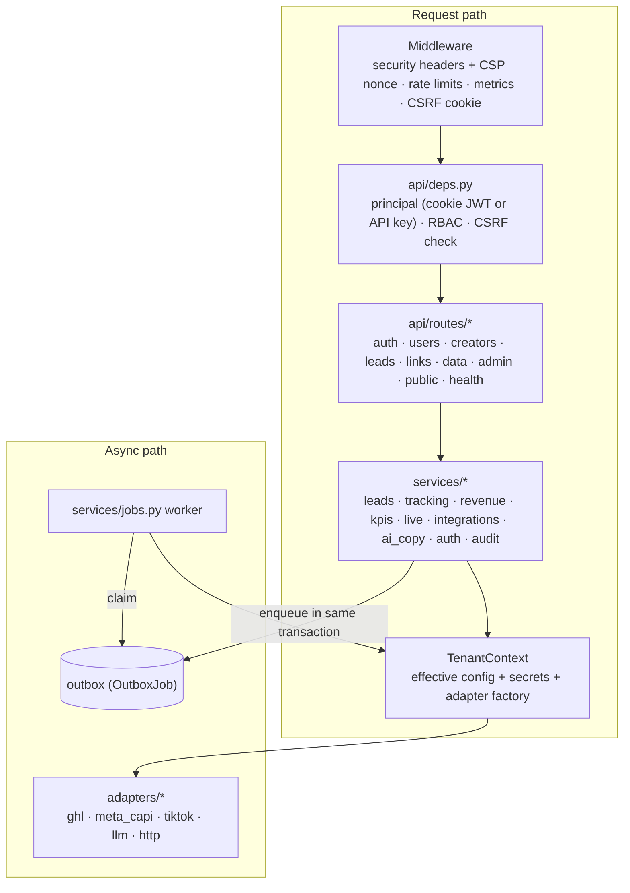

# Architecture

OFM Engine is one Python package (`ofm_engine`) that serves three surfaces from one FastAPI app,
plus a background worker that performs every call to an outside provider.

| Surface | Paths | Auth |
|---|---|---|
| REST API | `/api/v1/*` (contract: [api-contract.md](api-contract.md)) | cookie session (JWT + CSRF) or `X-API-Key` |
| Public pages | `/apply/{tenant}`, `/c/{tenant}/{creator}`, `/l/{slug}` | none (rate-limited) |
| SPA | every other non-API `GET` → `src/ofm_engine/web/dist/index.html` | cookie session |
| Ops | `/healthz`, `/readyz`, `/metrics` (also under `/api/v1`) | `/metrics` needs `Bearer $METRICS_TOKEN` |

## Source layout

| Path | Responsibility |
|---|---|
| `app.py` | App factory: middleware, routers, SPA mount, live listeners, optional in-process worker |
| `settings.py` | 12-factor settings (env / `.env`), safe dev defaults, `production_problems()` boot guard |
| `tenant_config.py` | Per-agency config model, YAML loading, admin-editable overrides, secret names |
| `models.py` | SQLAlchemy 2 models (UUID keys, `tenant_id` on every business table, soft deletes) |
| `db.py` | Engine/session factory (SQLite in dev, Postgres via psycopg 3 in production) |
| `api/` | Routers, dependencies (auth, RBAC, CSRF), middleware, cookies, pagination, serializers, error envelope |
| `services/` | Business logic; never imports FastAPI request objects |
| `adapters/` | Provider clients; each ships an in-process `httpx.MockTransport` emulation used in mock mode |
| `security/` | Envelope crypto, passwords, tokens/TOTP/API keys, HMAC signing, SSRF guard, rate limiter |
| `scoring.py`, `attribution.py`, `hashing.py` | Pure functions: lead scoring, click/UTM/fbc/fbp parsing, PII normalisation + hashing |
| `templates/` | Jinja pages: funnel, thank-you, link-in-bio, Pixel redirect interstitial |
| `cli.py` | `ofm` Typer CLI |
| `alembic/` (repo root, packaged into the wheel as `_migrations`) | Database migrations |
| `frontend/` | React 18 + Vite SPA; builds into `src/ofm_engine/web/dist` |

## Multi-tenancy

- One database holds many agencies (`tenants`). Every business row carries `tenant_id`.
- Authenticated requests resolve a `Principal` (user or API key) whose `tenant_id` comes from the
  signed token / key record — never from the request body or URL. Services receive a
  `TenantContext` built from that id and filter every query on `ctx.tenant_id`.
- Public routes resolve the tenant from the URL slug (validated against `^[a-z0-9][a-z0-9-]{1,62}$`)
  and only ever read that tenant's active records.
- Roles: `admin` (users, integrations, audit, API keys, webhook create/delete, deletes),
  `member` (all other business routes), `service` (API keys: business routes, never
  session-only routes such as `/auth/me`).

### Configuration layering

Later layers win:

1. Defaults in the Pydantic models (`tenant_config.py`).
2. `clients/<slug>.yaml` — version-controlled, **no secrets** (branding, funnel copy and variants,
   GHL ids and stage map, Meta/TikTok ids, feature flags, scoring weights, revenue CSV mapping).
3. `tenants.overrides` — JSON edited by admins (Settings → Integrations writes the non-secret ids
   here). Only `brand, funnel, ghl, meta, tiktok, features, scoring, target_timezones` may be
   overridden.

Secrets resolve from the encrypted vault (`tenant_secrets`) first, then from
`CLIENT_<SLUG>_<NAME>` environment variables.

## Request lifecycle: a creator applies

1. `GET /apply/{slug}` renders the funnel with a variant (sticky cookie), a fresh `event_id`
   and — if a Pixel id is configured — the Meta Pixel `PageView`, all under a nonce-based CSP.
2. The form posts JSON to `POST /api/v1/public/{slug}/apply` (or the no-JS form to
   `POST /apply/{slug}`). Validation requires `age_confirmed` **and** `consent`; the honeypot
   field short-circuits bots.
3. `services/leads.submit_application` in **one transaction**: normalises the email, checks the
   per-tenant idempotency key, stores the lead with consent version + timestamp and a keyed
   email hash, scores it, records a `Lead` conversion event, and enqueues outbox jobs —
   `ghl.upsert_lead`, `meta_capi.send`, `tiktok.send` (if enabled), `alert.send` (hot/warm),
   and `webhook.deliver` per matching subscription — plus an `Activity` row for the live feed.
4. The browser fires `fbq('track','Lead', …, {eventID})` with the same `event_id`, so Meta
   de-duplicates browser and server events.
5. The worker sends the jobs. `ghl.upsert_lead` upserts the contact, tags it, adds the score
   note, optionally enrols it in a workflow and enqueues `ghl.opportunity`.

## Outbox and worker (`services/jobs.py`)

- **Transactional outbox:** a job row exists if and only if the business change committed.
  `idempotency_key` is unique per tenant, so enqueuing the same logical job twice is a no-op.
- **Claiming:** `SELECT … FOR UPDATE SKIP LOCKED` on Postgres (many workers in parallel); an
  optimistic conditional `UPDATE` on SQLite. Jobs stuck in `running` past a 300 s lease are
  re-claimed.
- **Failure handling:** the job's session is rolled back (no partial side effects), then the
  failure is recorded in a fresh transaction: `retry` with exponential backoff
  (5 s · 2ⁿ, capped at 1 h) or `dead` when attempts (default 6) are exhausted or the error is
  permanent (4xx, validation, unsafe URL). Dead jobs appear in the live feed and can be retried
  from the UI or `POST /automations/jobs/{id}/retry`.
- **Where it runs:** `ofm worker` as its own process, or a daemon thread in the web process
  when `RUN_WORKER_IN_PROCESS=true` (single-instance and free hosting).

Job kinds: `ghl.upsert_lead`, `ghl.opportunity`, `meta_capi.send`, `tiktok.send`,
`webhook.deliver`, `alert.send`.

## Live dashboard (`services/live.py`)

- `record_activity()` inserts an `Activity` row (monotonic `seq`) in the same transaction as the
  change. Wake-ups are a hint only: Postgres `pg_notify` (delivered on commit to every API
  instance that `LISTEN`s), Redis `PUBLISH` when `REDIS_URL` is set, or an in-process wake-up.
- `GET /api/v1/live/stream` waits for a wake-up or a short timeout, then reads rows with
  `seq > Last-Event-ID`, so a missed notification never loses data. Each batch emits `event`
  messages followed by one `kpi` message containing an **additive delta** that the SPA adds to
  its cached `/kpis` snapshots (all three ranges at once).
- KPI snapshots are cached ~30 s per tenant and range and invalidated on writes in the same
  process; with several API instances, other instances converge within the TTL.

## Integrations and modes

Each adapter decides its own mode from the tenant's credentials:

| Adapter | Live when | Mock behaviour |
|---|---|---|
| GoHighLevel | `GHL_TOKEN` secret **and** `ghl.location_id` | deterministic ids from an in-process emulation of the endpoints used |
| Meta CAPI | `META_CAPI_TOKEN` **and** `meta.pixel_id` | validates and hashes the payload exactly as live, returns `events_received` |
| TikTok Events | `TIKTOK_ACCESS_TOKEN` **and** `tiktok.pixel_code` | same, offline |
| LLM | an Anthropic/OpenAI key (tenant or env) | deterministic templates per brief |
| Outbound webhooks | `OUTBOUND_WEBHOOKS_LIVE=true` | signed and logged, not sent |
| Slack / Discord alerts | the tenant's webhook URL secret | logged |

Every provider call is recorded in `integration_logs` (adapter, operation, mode, status,
duration, redacted detail). Provider HTTP goes through `adapters/http.py`: an allowlisted host
check, timeouts, and retries with jittered backoff on 408/425/429/5xx (honouring `Retry-After`).

## Data model (main tables)

`tenants`, `users`, `refresh_tokens`, `api_keys`, `tenant_secrets`, `audit_log`, `creators`,
`tracking_links`, `clicks`, `click_rollups_daily`, `leads`, `funnel_variants`, `events`
(conversion events), `revenue_records`, `outbox`, `activity`, `integration_logs`,
`webhook_subscriptions`, `inbound_webhooks` (plus an `ad_spend` table that v1.0 does not use yet).
See `src/ofm_engine/models.py` and `alembic/versions/` for exact columns.

## Frontend

React 18 + TypeScript + Vite + Tailwind, TanStack Query for server state, Recharts for charts.
`src/lib/api.ts` is the typed client (cookies + `X-CSRF-Token`, single-flight refresh on 401),
`src/lib/sse.ts` the EventSource wrapper, `src/lib/live.ts` applies KPI deltas. With
`VITE_MOCK=1`, `src/mock/` replaces `fetch` and `EventSource` with an in-browser API so the UI
can be demoed with no backend. Routes: `/`, `/login`, `/app` (dashboard), `/app/creators`,
`/app/pipeline`, `/app/links`, `/app/revenue`, `/app/automations`, `/app/ai`,
`/app/settings/{security|integrations|team|audit}`.

## Scaling notes

- API instances are stateless apart from the per-process KPI cache and the default in-memory
  rate limiter; set `REDIS_URL` to share rate limits when running more than one instance.
- Run as many `ofm worker` processes as needed; `SKIP LOCKED` keeps them from colliding.
- Postgres `LISTEN/NOTIFY` fans live events out to every instance without extra infrastructure.
