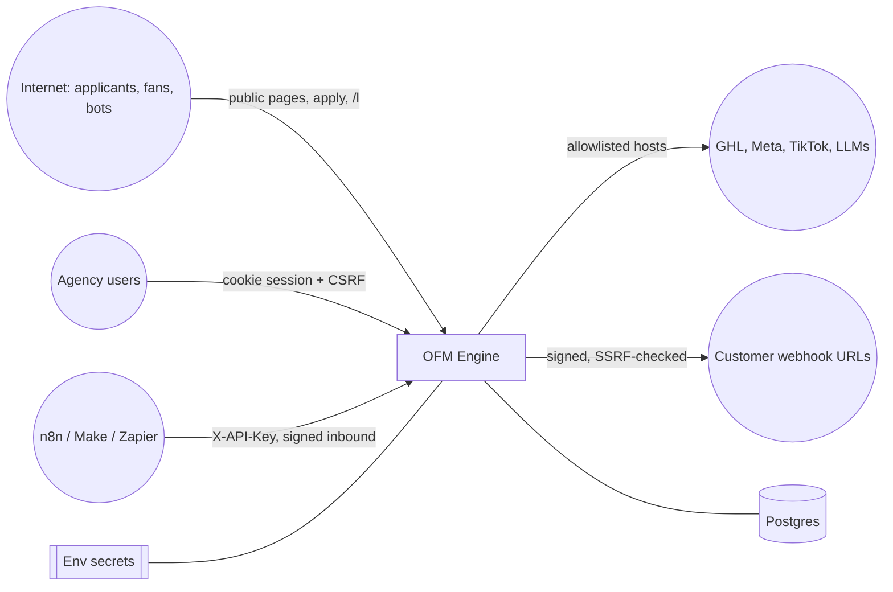

# Security

This document describes what OFM Engine protects, from whom, and how each control maps to code.
Vulnerabilities are reported privately — see [SECURITY.md](../SECURITY.md).

## Assets

| Asset | Where it lives | Why it matters |
|---|---|---|
| Applicant PII (name, email, phone, socials, timezone) | `leads` | Personal data of prospective creators; consent-bound |
| Integration credentials (GHL token, Meta/TikTok tokens, LLM keys, Slack/Discord URLs) | `tenant_secrets` (encrypted) or env | Grant write access to the agency's CRM and ad accounts |
| Webhook signing secrets | `webhook_subscriptions.secret_enc` (encrypted) | Let receivers trust our deliveries |
| User credentials and sessions | `users`, `refresh_tokens`, cookies | Account takeover → whole tenant |
| API keys | `api_keys` (SHA-256 hash only) | Automation access to business data |
| Revenue and KPI data | `revenue_records`, rollups | Commercially sensitive per agency |
| Server secrets (`MASTER_KEYS`, `JWT_SECRET`, `PII_HASH_SALT`) | environment only | Root of trust for everything above |

## Trust boundaries and threat actors

| Actor | Goals | Primary controls |
|---|---|---|
| Anonymous internet user / bot | Spam the funnel, enumerate tenants, inflate clicks, exploit page rendering | Rate limits, honeypot, strict validation, bot filtering in click stats, CSP nonces, auto-escaping templates |
| Credential stuffer | Take over agency accounts | argon2id, lockout, timing-equalised login, TOTP, auth rate limit |
| Malicious or compromised tenant user | Read another agency's data, escalate role, pivot to internal network via webhooks | Tenant-scoped queries, RBAC, last-admin guard, SSRF guard, audit log |
| Stolen API key | Bulk data access, admin changes | Keys hashed at rest, revocable, `service` role cannot reach admin or session routes |
| Attacker replaying/forging webhooks | Move leads, inject events | HMAC-SHA256 with timestamp window and single-use signatures |
| Database dump / backup leak | Harvest secrets and PII | Envelope encryption with keys outside the DB; keyed hashes for IPs/visitors |
| Supply-chain attacker | Malicious dependency or action | Hash-pinned locks, digest-pinned images, SHA-pinned actions, audits in CI |

### Key threats (STRIDE)

| Threat | Example | Mitigation |
|---|---|---|
| **S**poofing | Forged inbound callback moves a lead to `signed` | `security/signing.py` HMAC over `"<t>.<body>"`, 300 s window, replay table `inbound_webhooks` |
| **T**ampering | Cross-tenant write by guessing an id | Every query filters on the principal's `tenant_id` (`services/context.py`, routes) |
| **R**epudiation | Admin denies changing an integration | `audit_log` rows for auth, users, API keys, integrations, webhooks, creators, links, imports, refused AI prompts |
| **I**nformation disclosure | Token in logs or API responses | Write-only integration API, `SecretStr` settings, log redaction (`logging_setup.py`) |
| **D**enial of service | Funnel flooding, huge CSV | Per-IP fixed-window limits per bucket, 5 MB CSV cap, 64 KB inbound body cap, bounded list pages |
| **E**levation of privilege | Member calls admin route; API key calls `/auth/me` | `require_admin` / `require_member` / `require_user` dependencies in `api/deps.py` |

## OWASP ASVS 4.0.3 Level 2 mapping

Status: ✅ implemented · ◐ partial / operator responsibility · ✗ not implemented (see gaps).

### V1 Architecture
| Req. | Control | Where |
|---|---|---|
| 1.4.x access control enforced server-side at a single point | ✅ | `api/deps.py` (`get_principal`, `require_roles`, `tenant_ctx`) |
| 1.5.x input validation at trusted layer | ✅ | Pydantic models on every route; `tenant_config.py` validators |
| 1.6.x key management, keys outside data store | ✅ | `security/crypto.py`; `MASTER_KEYS` env only; `ofm rotate-keys` |
| 1.14.x segregated, least-privilege deployment | ✅ | Non-root UID 10001, read-only rootfs and `cap_drop: ALL` in compose |

### V2 Authentication
| Req. | Control | Where |
|---|---|---|
| 2.1.1 / 2.1.2 password length 12–128 | ✅ | `security/passwords.py` (`MIN_LENGTH`, `MAX_LENGTH`) |
| 2.1.7 breached-password check | ◐ | small built-in common-password list only |
| 2.2.1 anti-automation | ✅ | 5 failures → 15 min lockout (`services/auth.py`), auth bucket 10/min/IP |
| 2.4.1 / 2.4.4 argon2id with strong cost | ✅ | defaults t=3, m=64 MiB, p=4; boot refuses below m=19 MiB, t=2; rehash on login |
| 2.5.x credential recovery | ✗ | no self-service reset; admins set or regenerate passwords |
| 2.8.x TOTP second factor | ✅ | `security/tokens.py` (pyotp), secret envelope-encrypted (`users.totp_secret_enc`) |
| 2.2.x user enumeration resistance | ✅ | dummy-hash timing equaliser; uniform `invalid_credentials` |

### V3 Session management
| Req. | Control | Where |
|---|---|---|
| 3.2.x unpredictable tokens | ✅ | `secrets` module; refresh tokens stored as SHA-256 only |
| 3.3.1 logout invalidates session | ✅ | `/auth/logout` revokes the refresh family and clears cookies |
| 3.3.2 short-lived sessions | ✅ | 15 min access JWT, 14-day rotating refresh |
| 3.3.3 terminate other sessions on credential change | ✅ | `token_version` bump on password/role/active changes |
| 3.4.x cookie attributes | ✅ | `api/cookies.py`: httpOnly, `Secure` in production, SameSite Lax/Strict, refresh scoped to `/api/v1/auth` |
| 3.5.x token reuse detection | ✅ | replaying a rotated refresh token revokes the whole family (`refresh_reused`) |
| 4.2.2 / 3.5.x CSRF | ✅ | double-submit `csrf_token` + `X-CSRF-Token`, constant-time compare (`tokens.csrf_matches`) |

### V4 Access control
| Req. | Control | Where |
|---|---|---|
| 4.1.x deny by default, least privilege | ✅ | every business router depends on a role guard |
| 4.2.1 IDOR protection | ✅ | lookups by `(tenant_id, id)`; covered by `tests/test_rbac_tenancy.py` |
| 4.3.1 admin interface protection | ✅ | admin-only users, integrations, audit, API keys; last-admin and self-delete guards |
| 4.3.x MFA for admins | ◐ | available to every user, not enforced by policy |

### V5 Validation, sanitisation and encoding
| Req. | Control | Where |
|---|---|---|
| 5.1.x schema validation, length limits | ✅ | Pydantic field limits; slugs and handles regex-validated |
| 5.2.6 SSRF | ✅ | `security/ssrf.py`: https only, no credentials/odd ports, all resolved IPs public, re-checked at send time; provider hosts allowlisted |
| 5.3.x output encoding / XSS | ✅ | Jinja autoescape, React escaping, CSP nonce (no inline script without nonce) |
| 5.3.4 SQL injection | ✅ | SQLAlchemy parameterised queries only |
| 5.5.x deserialisation | ✅ | JSON and `yaml.safe_load` only |

### V6 Stored cryptography
| Req. | Control | Where |
|---|---|---|
| 6.2.x approved algorithms | ✅ | AES-256-GCM data keys, Fernet (AES-128-CBC + HMAC) key wrapping, HMAC-SHA256, argon2id |
| 6.2.x AEAD binding | ✅ | associated data = tenant id + secret name; copied rows fail to decrypt |
| 6.4.x key rotation | ✅ | prepend key to `MASTER_KEYS`, `ofm rotate-keys`, drop old key |
| 6.1.x PII at rest | ◐ | IPs/visitors and email lookup stored as keyed hashes; applicant name/email/phone stored in plaintext columns — rely on database encryption at rest |

### V7 Errors and logging
| Req. | Control | Where |
|---|---|---|
| 7.1.x no secrets/PII in logs | ✅ | `logging_setup.redact` (bearer tokens, `pit-`, `sk-`, `EAA…`, API keys, emails, phones) |
| 7.2.x security events logged | ✅ | `audit_log` + structured JSON logs; IPs stored as keyed hashes |
| 7.4.1 generic error messages | ✅ | `api/errors.py` uniform `{"error":{code,message}}` envelope |

### V8 Data protection
| Req. | Control | Where |
|---|---|---|
| 8.1.x no caching of sensitive responses | ✅ | `Cache-Control: no-store` on funnel and redirect pages |
| 8.3.x minimal data, write-only secrets | ✅ | integrations API returns only `set: bool`; secrets shown once (webhook, API key, temp password) |
| 8.3.x data deletion | ◐ | soft deletes in the API; no self-service erasure endpoint yet (see [compliance.md](compliance.md)) |

### V9 Communications
| Req. | Control | Where |
|---|---|---|
| 9.1.x TLS everywhere | ◐ | HSTS (2 years, preload) in production; TLS terminated by the platform/proxy |
| 9.2.x outbound TLS | ✅ | all provider URLs https; webhooks must be https |

### V10 Malicious code / supply chain
| Req. | Control | Where |
|---|---|---|
| 10.3.x integrity of dependencies | ✅ | `requirements/*.lock` with `--require-hashes`, `package-lock.json`, digest-pinned base images, SHA-pinned actions |
| 10.x scanning | ✅ | CI: pip-audit, bandit, npm audit, gitleaks (full history); release SBOM + provenance |

### V11 Business logic
| Req. | Control | Where |
|---|---|---|
| 11.1.x anti-automation on business flows | ✅ | honeypot, per-IP limits, idempotent applications, bot-filtered click counts |
| 11.1.x sequential/atomic processing | ✅ | transactional outbox, idempotency keys, `SKIP LOCKED` claiming |

### V12 Files and resources
| Req. | Control | Where |
|---|---|---|
| 12.1.x upload size limits | ✅ | CSV ≤ 5 MB, UTF-8 only, parsed in memory, never written to disk |

### V13 API and web services
| Req. | Control | Where |
|---|---|---|
| 13.1.x same auth on every API | ✅ | single `get_principal` dependency |
| 13.2.x content-type, schema | ✅ | JSON bodies validated; inbound hooks ≤ 64 KB |
| webhook authenticity | ✅ | outbound `X-OFM-Signature`, `X-OFM-Delivery` for receiver de-duplication |

### V14 Configuration
| Req. | Control | Where |
|---|---|---|
| 14.1.x secure build | ✅ | multi-stage Dockerfile, wheel installed `--no-deps` from hashed lock |
| 14.3.x no debug in production | ✅ | `settings.production_problems()` refuses dev JWT/master key/salt, SQLite, weak argon2, private outbound |
| 14.4.x security headers | ✅ | `api/middleware.py`: CSP with nonce, `nosniff`, `X-Frame-Options: DENY`, Referrer-Policy, Permissions-Policy, COOP, CORP, HSTS |
| 14.5.x CORS | ✅ | no CORS unless `CORS_ORIGINS` is set explicitly |

## Known gaps and operator responsibilities

- **No self-service password reset** and **MFA is optional** — enforce 2FA for admins by policy.
- **Applicant PII is not field-level encrypted**; use a managed Postgres with encryption at rest
  and restrict database access.
- **Data-subject erasure** is a manual database operation in v1.0 (no API endpoint).
- The in-memory rate limiter is per process; set `REDIS_URL` when running several API instances.
- `PII_HASH_SALT` must never change after go-live and must not be shared between environments.
- Keep `OUTBOUND_ALLOW_PRIVATE=false` in production (boot refuses otherwise).
- `/metrics` exposes operational data; keep `METRICS_TOKEN` secret.
- GHL native webhook signature verification (`adapters/ghl.verify_ghl_signature`, Ed25519 +
  legacy RSA) is implemented and tested but not yet exposed as a public route; GHL events reach
  OFM Engine through the signed inbound endpoint via n8n/Make/Zapier.

## Operational security

- Generate secrets: `ofm gen-key` (Fernet for `MASTER_KEYS`), and
  `python -c "import secrets;print(secrets.token_urlsafe(48))"` for `JWT_SECRET`,
  `PII_HASH_SALT` and `METRICS_TOKEN`.
- Rotate master keys: `MASTER_KEYS=new,old` → `ofm rotate-keys` → `MASTER_KEYS=new`.
- Rotate `JWT_SECRET` to log everyone out.
- Revoke API keys and webhook subscriptions from **Automations** when a tool or person leaves.
- Run `ofm doctor` after every configuration change.
